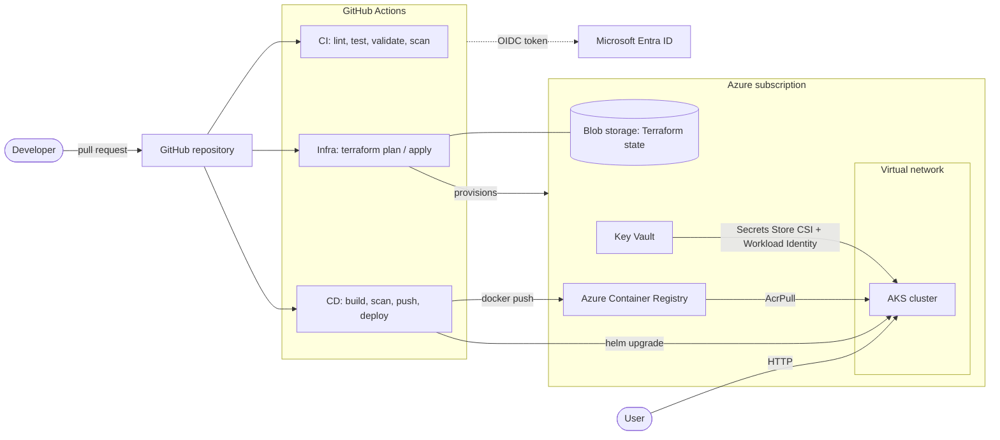

# Azure AKS Platform Engineering

[](https://github.com/sreepradat/azure-aks-platform-engineering/actions/workflows/ci.yml)
[](LICENSE)

A production-style platform on **Azure Kubernetes Service**: infrastructure as code with **Terraform**, a **Docker** image built and scanned in **GitHub Actions** using **reusable workflows**, passwordless authentication with **OpenID Connect**, and secrets delivered from **Azure Key Vault** through **Workload Identity**. No long-lived credentials exist anywhere in the pipeline.

> Personal portfolio project. It mirrors the patterns I use in platform engineering work (reusable GitHub Actions, multi-cloud deployments, secrets management, release versioning), rebuilt from scratch with a public, self-contained example.

## Architecture



More detail, including the authentication flows, is in [docs/architecture.md](docs/architecture.md).

## What this demonstrates

| Area | Implementation |
|---|---|
| Infrastructure as code | Terraform with reusable modules (network, ACR, AKS, Key Vault, workload identity), remote state in Azure Blob with versioning |
| CI/CD | GitHub Actions with **reusable workflows** (`workflow_call`) for build, Terraform and Helm deploy, called by thin pipelines |
| Passwordless auth | GitHub to Azure through **OIDC federation**: no client secrets, no stored credentials |
| Secrets management | Key Vault + Secrets Store CSI driver, accessed by the pod through **Azure Workload Identity** (no secrets in manifests or images) |
| Container security | Multi-stage build, non-root user, read-only root filesystem, dropped capabilities, **Trivy** image scan gates the push |
| IaC quality gates | `terraform fmt`, `validate`, **Checkov** scan, `hadolint`, `helm lint` on every pull request |
| Kubernetes | Helm chart with probes, resource limits, HPA, PodDisruptionBudget, and a hardened security context |
| Release safety | Images tagged with the commit SHA, `helm --atomic` rolls back failed deploys, environment approvals gate apply and deploy |
| Observability | `/metrics` endpoint in Prometheus format (request count and latency) |
| Cost control | Free AKS tier, small autoscaled node pool, one-click destroy workflow |

## Repository layout

```
.
├── app/                         Flask service, tests, Dockerfile
├── helm/sample-app/             Helm chart (Deployment, Service, HPA, PDB, SecretProviderClass)
├── terraform/
│   ├── modules/                 network, acr, aks, keyvault, workload-identity
│   └── environments/dev/        Composition of the modules for the dev environment
├── .github/workflows/
│   ├── ci.yml                   Lint, test, validate, scan (pull requests)
│   ├── infra.yml                Terraform plan on PR, apply after approval on main
│   ├── cd.yml                   Build, scan, push and deploy on main
│   ├── destroy.yml              Manual teardown of the dev environment
│   └── reusable-*.yml           Reusable building blocks (docker build, terraform, helm deploy)
├── scripts/                     One-time setup: remote state, GitHub OIDC, pipeline variables
└── docs/                        Architecture notes
```

## Prerequisites

- An Azure subscription with permission to create resources and role assignments (Owner, or Contributor plus User Access Administrator)
- Permission to create app registrations in Microsoft Entra ID
- Local tools: [Azure CLI](https://learn.microsoft.com/cli/azure/install-azure-cli), [GitHub CLI](https://cli.github.com/), [Terraform](https://developer.hashicorp.com/terraform/install) >= 1.9, Python 3.12 (for local tests); Docker and Helm are optional locally

## Quick start

### 1. Create your repository

Create a new GitHub repository named `azure-aks-platform-engineering` and push this code to it. If you use a different owner or name, set `GITHUB_REPO=<owner>/<repo>` for the scripts below and update the badge URLs in this README.

### 2. Sign in and create the Terraform state storage

```bash
az login
gh auth login
./scripts/bootstrap-state.sh
```

The script prints the state storage names. Copy `terraform/environments/dev/backend.hcl.example` to `backend.hcl` and fill in those values.

### 3. Connect GitHub Actions to Azure with OIDC

```bash
export TFSTATE_RESOURCE_GROUP=<value printed above>
export TFSTATE_STORAGE_ACCOUNT=<value printed above>
GITHUB_REPO=<owner>/<repo> ./scripts/setup-github-oidc.sh
```

This creates an app registration with federated credentials for pull requests, the `main` branch and the `dev` environment, grants the roles the pipelines need, and sets the GitHub repository variables.

Then, in the GitHub repository, create an environment named **`dev`** (Settings > Environments) and add yourself as a **required reviewer**. Every `terraform apply` and every deployment will then wait for your approval.

### 4. Provision the infrastructure

Either let the pipeline do it (merge to `main`, then approve the `dev` environment in the **Infra** workflow run) or run it locally:

```bash
cd terraform/environments/dev
terraform init -backend-config=backend.hcl
terraform plan -out=tfplan
terraform apply tfplan
```

Commit the generated `.terraform.lock.hcl` so provider versions are pinned for everyone.

### 5. Publish the deployment variables

```bash
GITHUB_REPO=<owner>/<repo> ./scripts/set-deploy-variables.sh
```

This reads the Terraform outputs and sets `RESOURCE_GROUP`, `AKS_NAME`, `ACR_NAME`, `KEY_VAULT_NAME` and `WORKLOAD_IDENTITY_CLIENT_ID` as repository variables.

### 6. Deploy

Run the **CD** workflow manually (Actions > CD > Run workflow), or push a change under `app/` or `helm/`. The pipeline builds the image, scans it with Trivy, pushes it to ACR, and runs `helm upgrade --install --atomic`. The workflow summary shows the public endpoint.

### 7. Verify

```bash
az aks get-credentials --resource-group rg-aksplat-dev --name aks-aksplat-dev
kubectl get pods,svc -n sample-app
curl http://<EXTERNAL-IP>/
```

Expected response, where `secret_loaded: true` proves the pod read the Key Vault secret through Workload Identity:

```json
{"environment":"dev","secret_loaded":true,"service":"sample-app","version":"<commit-sha>"}
```

## Pipelines

| Workflow | Trigger | What it does |
|---|---|---|
| **CI** | Pull request, push to `main` | `ruff` + `pytest`; `terraform fmt` and `validate`; `helm lint` and render; `hadolint`; Checkov (report-only) |
| **Infra** | PR touching `terraform/` | `terraform plan`, shown in the run summary |
| **Infra** | Push to `main` touching `terraform/` | Plan, then apply after the `dev` environment approval |
| **CD** | Push to `main` touching `app/` or `helm/`, or manual | Build, Trivy scan, push to ACR, Helm deploy with automatic rollback |
| **Destroy** | Manual, requires typing `destroy` | `terraform destroy` for the dev environment |

The three `reusable-*.yml` workflows take their configuration as inputs, so they can be moved into a dedicated shared repository and called from other projects as `uses: <owner>/platform-actions/.github/workflows/reusable-docker-build.yml@v1`, with versioned tags. This is the pattern for sharing pipelines across many repositories.

## Design decisions

- **OIDC instead of stored credentials.** Each workflow run exchanges a short-lived GitHub token for an Azure token. The federated credentials restrict which repository, branch, pull request and environment may sign in. Nothing needs to be rotated or can leak from the repository settings.
- **Workload Identity instead of pod secrets.** The pod's service account is federated to a user-assigned managed identity that can read one Key Vault and nothing else (`Key Vault Secrets User`). The secret is mounted as a file by the CSI driver and rotates automatically.
- **Scan before push.** The image is built locally in the runner, scanned by Trivy, and only pushed to the registry if it passes, so vulnerable images never reach ACR.
- **Plan on PR, apply behind approval.** Infrastructure changes are reviewed as a plan before merge, and the apply job reuses the exact saved plan after a human approves the `dev` environment.
- **Immutable image tags.** Deployments reference the short commit SHA, never `latest`, so every running version maps to a commit and rollbacks are exact.
- **Atomic Helm releases.** A failed rollout is rolled back automatically, so a bad release does not leave the service half deployed.
- **Least-privilege roles.** The kubelet identity gets `AcrPull` only; the workload gets `Key Vault Secrets User` only; the registry admin account is disabled.

## Cost and cleanup

With the defaults (AKS Free tier, one to two `Standard_B2s` nodes, Basic ACR, Standard LB) the environment costs a few US dollars per day while running. **Destroy it when you are not using it:**

- Run the **Destroy** workflow, or
- `cd terraform/environments/dev && terraform destroy`

The state storage account created by `bootstrap-state.sh` costs almost nothing and can stay.

If the cluster fails to create because of VM quota in your region, set `node_vm_size` (for example `Standard_D2s_v3`) or `location` in `terraform.tfvars`; see `terraform.tfvars.example`.

## Local development

```bash
python -m venv .venv && source .venv/bin/activate
make install        # app + dev dependencies
make check          # ruff, pytest, terraform validate, helm lint
make run            # http://localhost:8080
make docker-build && make docker-run
```

`make help` lists every target.

## Security notes

- The demo secret value in the Key Vault module is a placeholder to prove the flow. In real projects create secrets out of band so they never enter Terraform state.
- Checkov runs in report-only mode (`soft_fail: true`). Triage the findings and either fix them or suppress them with a written justification, then turn enforcement on.
- The service is exposed through a public load balancer for the demo. In production, put it behind an ingress controller with TLS and restrict access.
- The pipeline identity has `Contributor` and `User Access Administrator` at subscription scope for simplicity. In production, scope it to a resource group or use a conditioned role-assignment administrator role.
- Never commit `terraform.tfvars`, `backend.hcl` or state files; they are in `.gitignore`.

## Roadmap

- [ ] GitOps with Argo CD instead of pushing with Helm from the pipeline
- [ ] Ingress with cert-manager and TLS
- [ ] Prometheus and Grafana, with alerts on the exposed metrics
- [ ] Policy as code (Azure Policy / Kyverno)
- [ ] Separate `staging` and `prod` environments with promotion between them
- [ ] Image signing with Cosign and an SBOM per build

## Author

**Sai Sreeprada Tummalapalli**: DevOps / Platform Engineer

[GitHub](https://github.com/sreepradat) · [LinkedIn](https://www.linkedin.com/in/sai-sreeprada-tummalapalli-4685211bb/)

## License

[MIT](LICENSE)
