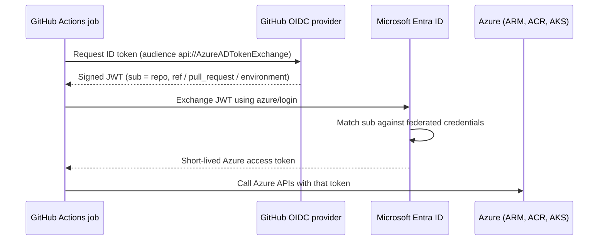
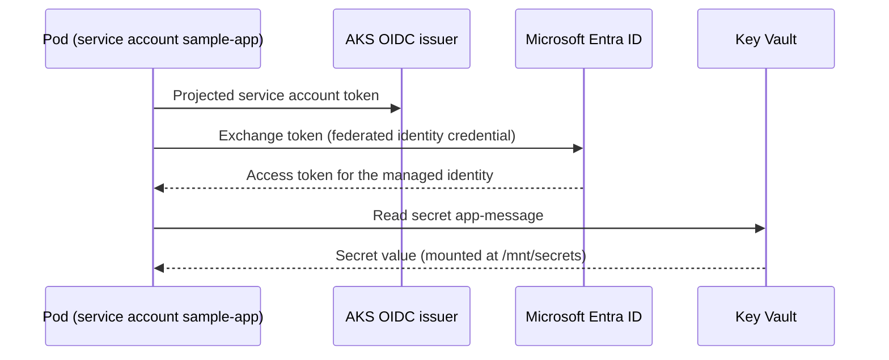
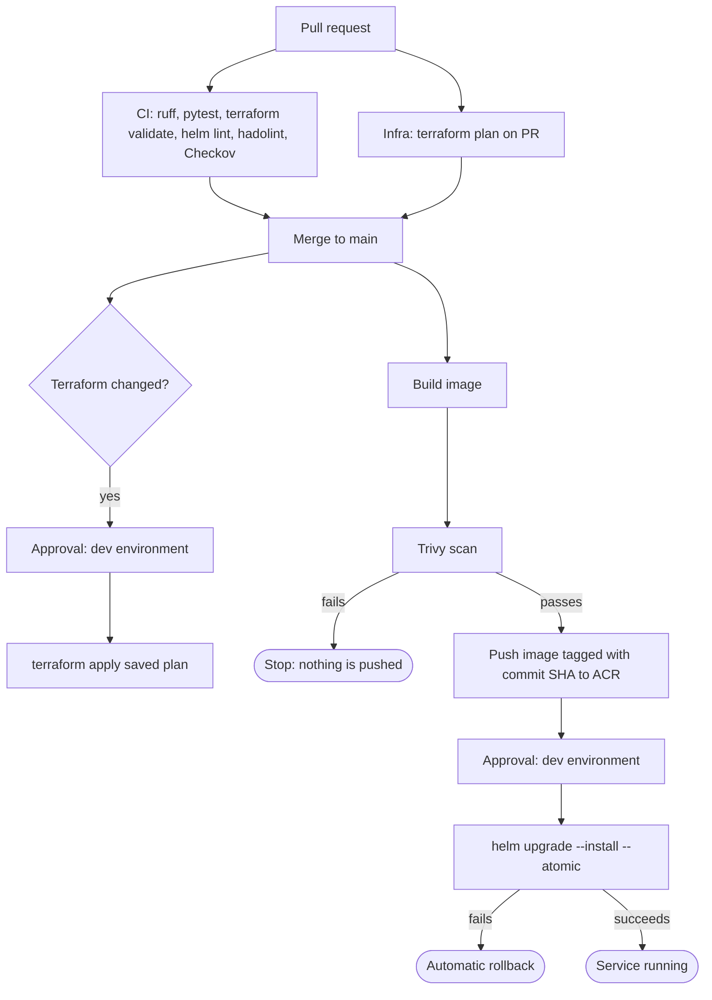
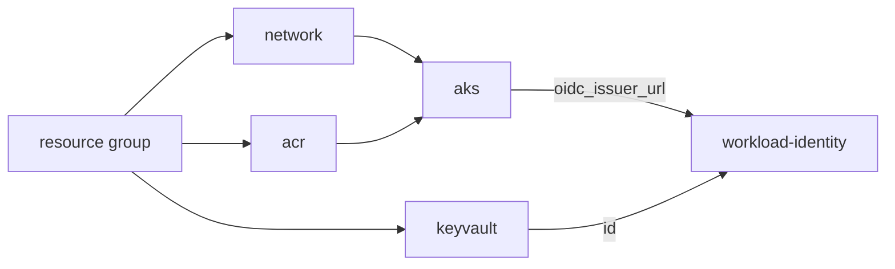

# Architecture

## Components

| Component | Purpose |
|---|---|
| Resource group `rg-aksplat-dev` | Holds everything in the dev environment, so it can be inspected and destroyed as one unit |
| Virtual network + `snet-aks` subnet | Network for the cluster nodes |
| AKS cluster | Runs the workload. OIDC issuer and Workload Identity enabled, Azure CNI overlay, Azure network policy, cluster autoscaler (1-2 nodes) |
| Azure Container Registry | Stores images. Admin account disabled; the cluster pulls with its kubelet identity (`AcrPull`) |
| Key Vault | Stores the demo secret. RBAC authorization, no access policies |
| User-assigned managed identity | The identity the pod assumes. Has `Key Vault Secrets User` on the vault only |
| Federated identity credential | Trusts tokens from the AKS OIDC issuer for exactly one service account (`system:serviceaccount:sample-app:sample-app`) |
| Storage account (created by script) | Terraform remote state, with blob versioning |
| Entra app registration (created by script) | Identity used by GitHub Actions through OIDC federation |

## Authentication flows

### GitHub Actions to Azure (OIDC)

Federated credentials exist for three subjects, so only these contexts can sign in:

| Subject | Used by |
|---|---|
| `repo:<owner>/<repo>:pull_request` | Terraform plan on pull requests |
| `repo:<owner>/<repo>:ref:refs/heads/main` | Plan and image build on `main` |
| `repo:<owner>/<repo>:environment:dev` | Terraform apply, Helm deploy, destroy (these wait for approval) |

### Pod to Key Vault (Workload Identity)

The Secrets Store CSI driver performs this exchange when the pod starts and refreshes the secret on rotation.

## Delivery flow

## Reusable workflow contracts

| Workflow | Key inputs | Outputs |
|---|---|---|
| `reusable-docker-build.yml` | `image-name`, `acr-name`, Azure IDs | `image-ref`, `image-repository`, `image-tag` |
| `reusable-helm-deploy.yml` | `environment`, `resource-group`, `cluster-name`, `image-repository`, `image-tag`, `workload-identity-client-id`, `key-vault-name`, Azure IDs | none (writes the endpoint to the run summary) |
| `reusable-terraform.yml` | `working-directory`, `environment`, `apply`, state backend settings, Azure IDs | none (writes the plan to the run summary) |

All environment-specific values are passed as inputs by the caller (`ci.yml`, `cd.yml`, `infra.yml`), which read them from repository variables. Nothing is hardcoded inside the reusable workflows, which is what makes them shareable across repositories.

## Terraform module graph

